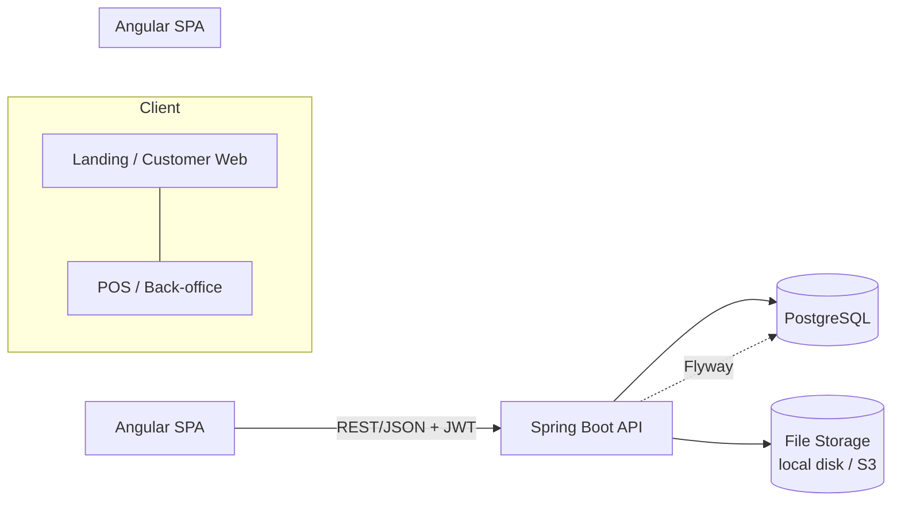
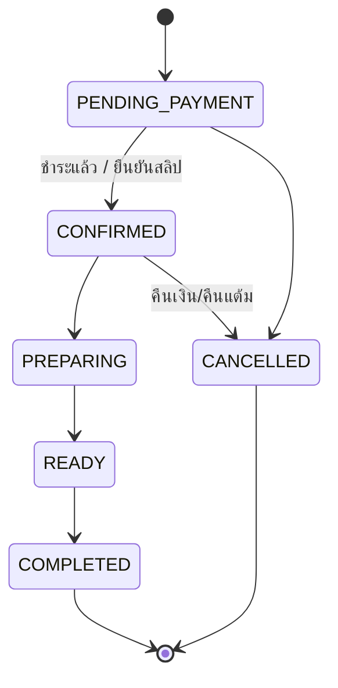

# 01 — ภาพรวมระบบ

## 1. เป้าหมาย

- ลูกค้าดูเมนูได้ทันทีจากหน้า Landing โดยไม่ต้อง login
- ลูกค้า **Walk-in** จะสมัครสมาชิกหรือไม่ก็ได้ — ถ้าเป็นสมาชิก บอกเบอร์โทรที่หน้าร้านเพื่อสะสมแต้มได้
- สมาชิกสะสมแต้ม แลกแต้มเป็นส่วนลด และใช้โปรโมชั่นได้
- พนักงานรับออเดอร์ผ่านหน้า POS และรับเงินได้หลายช่องทาง (เงินสด / โอน / PromptPay)
- เจ้าของร้านดู Dashboard ยอดขาย สินค้าขายดี และจำนวนสมาชิก

## 2. Actor และสิทธิ์

| Role | คำอธิบาย | สิทธิ์หลัก |
|------|----------|-----------|
| `GUEST` | ผู้ที่ไม่ได้ login (รวมลูกค้า walk-in ที่ไม่สมัคร) | ดูเมนู/โปรโมชั่น, สั่งแบบ Guest (ชื่อ + เบอร์), ติดตามออเดอร์ด้วยรหัส |
| `CUSTOMER` | สมาชิก | ทุกอย่างของ GUEST + โปรไฟล์, แต้ม, ประวัติออเดอร์, โปรเฉพาะสมาชิก |
| `STAFF` | พนักงานหน้าร้าน | POS, คิวครัว, ยืนยันการชำระเงิน, ค้นหาสมาชิกด้วยเบอร์ |
| `ADMIN` | เจ้าของร้าน/ผู้จัดการ | ทุกอย่าง + จัดการเมนู, โปรโมชั่น, ประเภทการจ่ายเงิน, พนักงาน, ตั้งค่า, Dashboard |

## 3. Tech Stack

> ตรวจสอบเลขเวอร์ชันล่าสุดอีกครั้งตอนเริ่มโปรเจกต์ (`ng version`, start.spring.io)

| Layer | เทคโนโลยี |
|-------|-----------|
| Frontend | Angular (ล่าสุด) — standalone components, signals, zoneless, control flow `@if/@for` |
| UI | PrimeNG (เวอร์ชันที่ตรงกับ Angular) + `@primeuix/themes` (Aura preset ปรับสีแบรนด์) |
| CSS | Tailwind CSS v4 + `tailwindcss-primeui` plugin |
| Backend | Spring Boot 4.x, Java 25 (LTS) |
| Security | Spring Security + JWT (access token 15 นาที, refresh token 14 วัน เก็บใน DB แบบ hash) |
| Persistence | Spring Data JPA (Hibernate), MapStruct, Bean Validation |
| Database | PostgreSQL 17/18 |
| Migration | Flyway |
| API docs | springdoc-openapi (Swagger UI) → ใช้ generate TypeScript client/model ให้ FE ได้ |
| Test | JUnit 5, Testcontainers (PostgreSQL), Vitest/Jest (FE), Playwright (E2E) |
| Infra (dev) | Docker Compose: postgres + backend + frontend (nginx) |

## 4. สถาปัตยกรรม

- **Angular SPA เดียว** แบ่งเป็น 2 โซนด้วย route + layout: `PublicLayout` (ลูกค้า) และ `BackofficeLayout` (พนักงาน/แอดมิน)
- **Backend เป็น Modular Monolith** แยก package ตาม feature (auth, user, catalog, order, payment, point, promotion, dashboard) — แต่ละ module คุยกันผ่าน service interface ไม่เข้าถึง repository ข้าม module
- URL prefix: `/api/v1/public/**` (ไม่ต้อง login), `/api/v1/me/**` (สมาชิก), `/api/v1/admin/**` (STAFF/ADMIN)

## 5. Business Rules หลัก

### 5.1 สมาชิก
- สมัครด้วย **เบอร์โทร (unique, บังคับ)** + รหัสผ่าน, อีเมลไม่บังคับ
- Login ได้ทั้งเบอร์โทรหรืออีเมล
- ระบบออก `member_code` อัตโนมัติ เช่น `R5D-000123` (ใช้ทำ QR ให้พนักงานสแกนได้)

### 5.2 Walk-in
- พนักงานเปิดออเดอร์ที่ POS → ช่อง "เบอร์สมาชิก" ไม่บังคับ
  - ใส่เบอร์และพบสมาชิก → ผูกออเดอร์กับสมาชิก ได้แต้ม
  - ไม่ใส่ → ออเดอร์ `customer_id = NULL`
- พนักงานสมัครสมาชิกให้ลูกค้าที่หน้าร้านได้ (Quick register: ชื่อเล่น + เบอร์ → ส่งรหัสผ่านชั่วคราว/ตั้งเองภายหลัง)

### 5.3 ออเดอร์
- Channel: `WALK_IN` (สั่งที่ร้านผ่าน POS), `ONLINE` (สั่งผ่านเว็บ รับที่ร้าน)
- Status flow:

- ราคา ชื่อสินค้า และตัวเลือกใน `order_item` เป็น **snapshot** ณ เวลาสั่ง (แก้ราคาเมนูทีหลังไม่กระทบออเดอร์เก่า)
- ลำดับการคำนวณ (Pricing pipeline):
  `subtotal (รวม option)` → `- ส่วนลดโปรโมชั่น` → `- ส่วนลดจากแลกแต้ม` → `total` → `คำนวณแต้มที่ได้จาก total`

### 5.4 การชำระเงิน
| Code | ชื่อ | ต้องแนบสลิป | ยืนยันโดย |
|------|------|------------|-----------|
| `CASH` | เงินสด | ไม่ | พนักงานกดรับเงิน (บันทึกเงินที่รับ/เงินทอน) |
| `TRANSFER` | โอนเงินธนาคาร | ใช่ | พนักงานตรวจสลิป |
| `PROMPTPAY` | พร้อมเพย์ QR | ใช่ | พนักงานตรวจสลิป |
| `CARD` | บัตร (EDC) | ไม่ | พนักงานใส่เลขอ้างอิง |

- แอดมินเปิด/ปิด และเพิ่มประเภทการจ่ายเงินได้จากหลังบ้าน (ตาราง `payment_method`)
- 1 ออเดอร์มีได้หลาย payment (รองรับจ่ายผสม เช่น เงินสด + โอน) — ออเดอร์ `CONFIRMED` เมื่อยอด `PAID` รวม ≥ total

### 5.5 แต้ม (ค่าเริ่มต้น ปรับได้ใน `system_setting`)
- ได้ **1 แต้ม ต่อทุก 25 บาท** ของยอดสุทธิ (ปัดลง) — ได้เมื่อออเดอร์ `COMPLETED`
- แลก **10 แต้ม = ส่วนลด 1 บาท** ขั้นต่ำ 100 แต้ม, ใช้ลดได้ไม่เกิน 50% ของยอด
- แต้มหมดอายุ 365 วันนับจากวันที่ได้รับ
- ทุกการเปลี่ยนแปลงแต้มบันทึกใน `point_transaction` (ledger) — ยอดคงเหลือใน `customer_profile.points_balance` เป็นค่า cache ที่อัปเดตใน transaction เดียวกัน
- ยกเลิกออเดอร์ → คืนแต้มที่แลก / ดึงแต้มที่ได้กลับ

### 5.6 โปรโมชั่น
| Type | ตัวอย่าง |
|------|----------|
| `PERCENT` | ลด 10% (มีเพดานส่วนลดได้) |
| `FIXED_AMOUNT` | ลด 20 บาทเมื่อซื้อครบ 150 |
| `BUY_X_GET_Y` | ซื้อโรตีกล้วย 2 แถม 1 |
| `POINT_MULTIPLIER` | แต้ม x2 ทุกวันพุธ |

- เงื่อนไข: ช่วงวันเวลา, วันในสัปดาห์, ยอดขั้นต่ำ, เฉพาะสมาชิก, จำกัดจำนวนครั้งรวม/ต่อคน, ใช้กับสินค้า/หมวดที่กำหนด
- ใช้แบบ **Auto-apply** (ไม่ต้องมีโค้ด) หรือ **ใส่โค้ด**
- 1 ออเดอร์ใช้โปรส่วนลดได้ 1 รายการ + โปร `POINT_MULTIPLIER` ซ้อนได้

## 6. Non-functional
- ทุก API ตอบรูปแบบเดียวกัน (`ApiResponse`), error มี `code` ให้ FE map เป็นข้อความภาษาไทย
- Optimistic locking (`version`) ที่ตาราง order, customer_profile, promotion ป้องกันแต้ม/โควต้าเพี้ยน
- เวลาเก็บเป็น `TIMESTAMPTZ` (UTC) แสดงผลเป็น Asia/Bangkok
- เงินใช้ `NUMERIC(10,2)` ↔ `BigDecimal` เท่านั้น
- Audit: `created_at/by`, `updated_at/by` ทุกตารางหลัก
