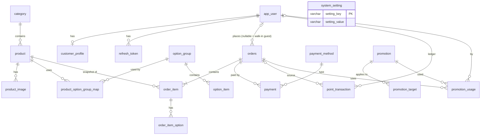

# 02 — Database Design (PostgreSQL + Flyway)

## 1. หลักการออกแบบ

| เรื่อง | แนวทาง |
|--------|--------|
| Primary key | `BIGINT GENERATED ALWAYS AS IDENTITY` (id ภายใน) — ถ้าต้องโชว์ภายนอกใช้ `order_no`, `member_code` แทน |
| ชื่อ | `snake_case`, ตารางเอกพจน์ (`product`, `orders` ใช้พหูพจน์เพราะ `order` เป็น reserved word) |
| Enum | `VARCHAR` + `CHECK` constraint (ง่ายต่อ JPA `@Enumerated(STRING)` และเพิ่มค่าผ่าน Flyway ได้) |
| เงิน | `NUMERIC(10,2)` |
| เวลา | `TIMESTAMPTZ` |
| Audit | `created_at`, `created_by`, `updated_at`, `updated_by` (+ `version` สำหรับ optimistic lock) |
| Soft delete | ข้อมูล master (product, category, promotion) ใช้ `is_active`/`deleted_at` ไม่ลบจริง เพราะออเดอร์อ้างอิงอยู่ |
| Snapshot | `order_item`, `order_item_option` เก็บชื่อ/ราคา ณ เวลาสั่ง |

## 2. ER Diagram



## 3. ตารางแยกตาม Phase

### Phase 1 — Users & Catalog (V1, V2)

**`app_user`** — บัญชีผู้ใช้ทุก role
| Column | Type | หมายเหตุ |
|--------|------|----------|
| id | BIGINT PK | |
| phone | VARCHAR(20) UNIQUE NOT NULL | ใช้ login |
| email | VARCHAR(150) UNIQUE NULL | ใช้ login ได้ |
| password_hash | VARCHAR(100) NOT NULL | BCrypt |
| role | VARCHAR(20) | `CUSTOMER`, `STAFF`, `ADMIN` |
| status | VARCHAR(20) | `ACTIVE`, `SUSPENDED` |
| last_login_at | TIMESTAMPTZ | |
| audit + version | | |

**`customer_profile`** — ข้อมูลสมาชิก (1:1 กับ app_user role CUSTOMER; staff ก็มีได้ถ้าต้องการสะสมแต้ม)
| Column | Type | หมายเหตุ |
|--------|------|----------|
| user_id | BIGINT PK/FK | |
| member_code | VARCHAR(20) UNIQUE | `R5D-000123` จาก sequence |
| first_name, last_name, nickname | VARCHAR | |
| birth_date | DATE | ใช้ทำโปรวันเกิดภายหลัง |
| gender | VARCHAR(10) | |
| avatar_url | VARCHAR(500) | |
| points_balance | INT NOT NULL DEFAULT 0 | cache ของ ledger (CHECK ≥ 0) |
| lifetime_points | INT NOT NULL DEFAULT 0 | ไว้ทำ tier |
| audit + version | | |

**`refresh_token`** — `id, user_id, token_hash, expires_at, revoked_at, user_agent, created_at`

**`system_setting`** — key/value สำหรับกติกาแต้ม, ข้อมูลร้าน, PromptPay ID ฯลฯ

**`category`** — `id, name, slug UNIQUE, description, icon, sort_order, is_active`

**`product`**
| Column | Type | หมายเหตุ |
|--------|------|----------|
| id | BIGINT PK | |
| category_id | FK | |
| code | VARCHAR(30) UNIQUE | เช่น `RT-BANANA` |
| name, description | | |
| price | NUMERIC(10,2) | |
| image_url | VARCHAR(500) | รูปหลัก |
| is_available | BOOLEAN | ของหมดชั่วคราว |
| is_recommended | BOOLEAN | แสดง "เมนูแนะนำ" บน landing |
| is_active | BOOLEAN | soft delete |
| sort_order | INT | |

### Phase 2 — Options & Images (V3)

- **`option_group`** — กลุ่มตัวเลือก เช่น "ท็อปปิ้งเพิ่ม", "ความหวาน": `name, min_select, max_select, is_active`
- **`option_item`** — `option_group_id, name, extra_price, is_available, sort_order` เช่น ไข่ +10, นมข้น +5
- **`product_option_group_map`** — M:N ระหว่าง product กับ option_group (+ `sort_order`)
- **`product_image`** — รูปเพิ่มเติม `product_id, url, sort_order`

### Phase 3 — Orders & Payments (V4, V5)

**`payment_method`** — `code UNIQUE, name, requires_slip, requires_reference, is_active, sort_order, instruction (เช่น เลขบัญชี)`

**`orders`**
| Column | Type | หมายเหตุ |
|--------|------|----------|
| id | BIGINT PK | |
| order_no | VARCHAR(20) UNIQUE | `R5D-250925-0001` (วันที่ + running ต่อวัน) |
| tracking_token | UUID UNIQUE | ให้ guest ติดตามออเดอร์ผ่านลิงก์ |
| channel | VARCHAR(20) | `WALK_IN`, `ONLINE` |
| status | VARCHAR(20) | ตาม state diagram |
| customer_id | FK app_user NULL | NULL = guest/walk-in ไม่สมัคร |
| guest_name, guest_phone | VARCHAR NULL | กรณี guest |
| subtotal | NUMERIC | ก่อนส่วนลด |
| promotion_discount | NUMERIC | |
| point_discount | NUMERIC | |
| total_amount | NUMERIC | ยอดสุทธิ (CHECK ≥ 0) |
| points_redeemed | INT | |
| points_earned | INT | บันทึกเมื่อ COMPLETED |
| note | TEXT | |
| queue_no | INT | เลขคิวต่อวันสำหรับเรียกลูกค้า |
| cashier_id | FK app_user NULL | พนักงานที่เปิดบิล |
| confirmed_at, completed_at, cancelled_at | TIMESTAMPTZ | |
| cancel_reason | TEXT | |
| audit + version | | |

**`order_item`** — `order_id, product_id, product_name, unit_price, options_price, quantity, line_total, note`

**`order_item_option`** — `order_item_id, option_item_id, option_group_name, option_name, extra_price`

**`payment`**
| Column | Type | หมายเหตุ |
|--------|------|----------|
| id | PK | |
| order_id | FK | |
| payment_method_id | FK | |
| amount | NUMERIC | |
| cash_received, change_amount | NUMERIC NULL | กรณีเงินสด |
| reference_no | VARCHAR | เลขอ้างอิงโอน/บัตร |
| slip_url | VARCHAR(500) | |
| status | VARCHAR(20) | `PENDING`, `PAID`, `REJECTED`, `REFUNDED` |
| paid_at | TIMESTAMPTZ | |
| verified_by | FK app_user | |
| reject_reason | TEXT | |

### Phase 4 — Points, Promotions, Reports (V6, V7, V8)

**`point_transaction`** (ledger, insert-only)
| Column | Type | หมายเหตุ |
|--------|------|----------|
| id | PK | |
| customer_id | FK | |
| order_id | FK NULL | |
| type | VARCHAR(20) | `EARN`, `REDEEM`, `ADJUST`, `EXPIRE`, `REVERSE` |
| points | INT | + ได้ / − ใช้ |
| balance_after | INT | |
| remaining | INT | เฉพาะ EARN — แต้มที่ยังไม่ถูกใช้/หมดอายุ (FIFO) |
| expires_at | TIMESTAMPTZ | เฉพาะ EARN |
| remark | VARCHAR | |
| created_at, created_by | | |

**`promotion`**
| Column | Type | หมายเหตุ |
|--------|------|----------|
| id | PK | |
| code | VARCHAR(30) UNIQUE NULL | NULL = auto-apply |
| name, description, banner_url | | |
| type | VARCHAR(20) | `PERCENT`, `FIXED_AMOUNT`, `BUY_X_GET_Y`, `POINT_MULTIPLIER` |
| discount_value | NUMERIC | % หรือ บาท หรือ ตัวคูณ |
| max_discount | NUMERIC NULL | เพดานสำหรับ PERCENT |
| buy_qty, get_qty | INT NULL | สำหรับ BUY_X_GET_Y |
| min_order_amount | NUMERIC | |
| scope | VARCHAR(20) | `ORDER`, `PRODUCT`, `CATEGORY` |
| member_only | BOOLEAN | |
| channel | VARCHAR(20) | `ALL`, `WALK_IN`, `ONLINE` |
| days_of_week | SMALLINT[] | 1=จันทร์ … 7=อาทิตย์, NULL = ทุกวัน |
| start_at, end_at | TIMESTAMPTZ | |
| usage_limit, usage_per_customer | INT NULL | |
| used_count | INT | |
| show_on_landing | BOOLEAN | |
| priority | INT | ใช้ตัดสินเมื่อ auto-apply หลายตัว |
| is_active + audit + version | | |

**`promotion_target`** — `promotion_id, product_id NULL, category_id NULL` (CHECK: ต้องมีอย่างใดอย่างหนึ่ง)

**`promotion_usage`** — `promotion_id, order_id, customer_id NULL, discount_amount, created_at`

**Views (V8)** สำหรับ Dashboard: `v_daily_sales`, `v_product_sales` (นับเฉพาะออเดอร์ `COMPLETED`)

## 4. Index สำคัญ

| ตาราง | Index | เหตุผล |
|-------|-------|--------|
| orders | `(status, created_at)` | คิวครัว / รายการวันนี้ |
| orders | `(customer_id, created_at DESC)` | ประวัติสมาชิก |
| orders | `(created_at)` | รายงาน |
| product | `(category_id, is_active, sort_order)` | Landing |
| point_transaction | `(customer_id, created_at DESC)` | หน้าแต้ม |
| point_transaction | `(expires_at) WHERE type='EARN' AND remaining > 0` | job หมดอายุ |
| promotion | `(is_active, start_at, end_at)` | หาโปรที่ใช้ได้ |
| payment | `(status) WHERE status='PENDING'` | รายการรอตรวจสลิป |

## 5. Flyway Strategy

```
backend/src/main/resources/
└── db/
    ├── migration/        # ใช้ทุก environment
    │   ├── V1__init_users_and_settings.sql
    │   ├── ...
    └── seed/             # dev/test เท่านั้น
        └── R__dev_seed.sql
```

```yaml
# application.yml
spring:
  flyway:
    enabled: true
    locations: classpath:db/migration
  jpa:
    hibernate:
      ddl-auto: validate   # ห้าม update — schema มาจาก Flyway เท่านั้น
---
# application-dev.yml
spring:
  flyway:
    locations: classpath:db/migration,classpath:db/seed
```

กติกาทีม:
1. **ห้ามแก้ไฟล์ V ที่ merge แล้ว** — ต้องสร้าง version ใหม่เสมอ
2. 1 PR = 1 migration ต่อ feature, ตั้งชื่อ `V{n}__{verb}_{object}.sql`
3. ข้อมูล master ที่ต้องมีทุก env (payment_method, system_setting) ใส่ใน V-script, ข้อมูลตัวอย่างใส่ใน `seed`
4. CI รัน Testcontainers + Flyway migrate + `ddl-auto=validate` เพื่อตรวจว่า Entity ตรงกับ schema
