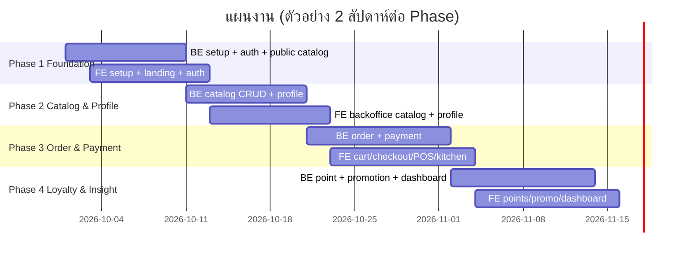
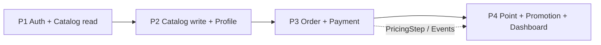

# 05 — แผน 4 Phase (FE ↔ BE สอดคล้องกัน)

หลักการ: **แต่ละ Phase ปิดเป็น vertical slice ที่ demo ได้จริง** — BE ส่ง API + migration, FE ส่งหน้าจอที่ใช้ API นั้น
BE ควรนำหน้า FE ประมาณ 2–3 วันในแต่ละ Phase (ส่ง OpenAPI spec ก่อน → FE generate client + mock ได้ทันที)

---

## Phase 1 — Foundation & Storefront

**เป้าหมาย demo**: ลูกค้าเปิดเว็บเห็นเมนูโรตีแยกหมวด สมัครสมาชิก และ login ได้

| Backend | Frontend |
|---------|----------|
| สร้างโปรเจกต์ Spring Boot, Docker Compose (postgres) | สร้างโปรเจกต์ Angular, Tailwind + PrimeNG theme |
| **Common layer**: ApiResponse, PageResponse, GlobalExceptionHandler, ErrorCode, AuditableEntity, JPA auditing, OpenAPI | **Core**: interceptors (auth, error, loading), guards, AuthStore, error-messages ไทย |
| Flyway **V1** (users, settings), **V2** (catalog), seed dev | Generate API client จาก OpenAPI |
| Spring Security + JWT + refresh token (cookie) | Layouts: PublicLayout, BackofficeLayout (โครง) |
| `POST /auth/register, /login, /refresh, /logout`, `GET /me` | หน้า Login, Register |
| `GET /public/menu, /categories, /products, /shop-info` | หน้า Landing |
| `AdminBootstrapRunner` | Shared: page-header, empty-state, skeleton, product-card, category-tabs, search-box, form-field, password-input, phone-input, money/thaiDate pipe |
| CI: build + Testcontainers | CI: lint + unit test + build |

**DoD**: สมัคร → login → refresh หลัง access token หมดอายุได้ · Landing แสดงเมนูจาก DB · role redirect ถูกต้อง · test ผ่าน

---

## Phase 2 — Catalog Management & Profile

**เป้าหมาย demo**: แอดมินเพิ่ม/แก้เมนู รูป ท็อปปิ้ง แล้วลูกค้าเห็นบน Landing ทันที · สมาชิกแก้โปรไฟล์ได้

| Backend | Frontend |
|---------|----------|
| Flyway **V3** (option groups, product images) | Shared: image-upload, data-table, confirm service, status-tag, avatar, `createCrudStore` |
| `FileStorageService` + `POST /files` | Backoffice: Categories, Products, Option Groups |
| Admin CRUD: categories, products, option-groups, availability | Product detail dialog บน Landing (แสดง option) |
| `/me/profile`, avatar, change password | Profile page (+ QR member code) |
| Admin: customers search/lookup/quick-register, staff, settings | Backoffice: Customers, Staff, Settings |
| `@PreAuthorize` ADMIN vs STAFF | Sidebar ตาม role, `roleGuard` |

**DoD**: เปลี่ยนราคา/ของหมด แล้ว landing แสดงถูก · STAFF เข้าเมนู ADMIN ไม่ได้ (ทั้ง FE และ BE) · อัปโหลดรูปจำกัดชนิด/ขนาด

---

## Phase 3 — Ordering & Payment

**เป้าหมาย demo**: (1) ลูกค้า walk-in ที่ไม่สมัคร สั่งผ่าน POS จ่ายเงินสด ได้เงินทอน (2) ลูกค้าออนไลน์สั่ง แนบสลิป พนักงานอนุมัติ → ออเดอร์ขึ้นคิวครัว → READY → COMPLETED

| Backend | Frontend |
|---------|----------|
| Flyway **V4** (payment_method + ค่าเริ่มต้น), **V5** (orders, items, payments, daily_counter) | Shared: qty-stepper, option-selector, order-summary, payment-method-picker, cash-calculator, order-timeline, member-lookup |
| `PricingService` + `PricingStep` (มี SubtotalStep) | CartStore + หน้า Cart (เรียก quote) |
| `/public/orders/quote`, `/public/orders`, track, แนบสลิป | Checkout (guest / member), Track order |
| `OrderStatusMachine`, `DailyCounterService` (order_no, queue_no) | POS |
| Admin: orders, board, status, cancel, receipt | Kitchen board (polling) |
| Payments: รับเงิน (cash/change), verify slip, pending list | Pending payments (ดูสลิป) |
| Admin payment-methods CRUD, public payment-methods | Settings › Payment methods |
| Event: `OrderCompletedEvent`, `OrderCancelledEvent` (ยังไม่มี listener) | Profile › My orders, Backoffice › Today |

**DoD**: ราคาใน DB = ราคาที่ FE แสดง (BE คำนวณเอง) · เปลี่ยนสถานะผิดลำดับถูกปฏิเสธ · จ่ายผสม (เงินสด+โอน) ได้ · order_no ไม่ซ้ำเมื่อสั่งพร้อมกัน (test concurrency) · walk-in ไม่ใส่เบอร์ได้ ใส่เบอร์แล้วผูกสมาชิกได้

---

## Phase 4 — Loyalty, Promotion & Dashboard

**เป้าหมาย demo**: สมาชิกสั่ง → ได้แต้ม → ครั้งถัดไปแลกแต้ม + ใช้โค้ดโปร · แอดมินสร้างโปร "พุธแต้ม x2" · เจ้าของดู Dashboard

| Backend | Frontend |
|---------|----------|
| Flyway **V6** (point_transaction), **V7** (promotion), **V8** (dashboard views) | Shared: point-badge, promo-banner/card, promo-code-input, point-redeem, stat-card, date-range-filter, chart-card |
| PointService (earn/redeem/reverse/adjust) + listeners + `PointExpiryJob` | Profile › Points, point badge ใน header |
| PromotionService + calculators (4 types) + `PromotionStep`, `PointRedeemStep`, `PointEarnPreviewStep` | Checkout & POS: ใส่โค้ด/แลกแต้ม/แสดงแต้มที่จะได้ |
| `/me/points*`, `/public/promotions*`, admin promotions CRUD/usages, adjust points | Landing: promotion carousel · หน้า Promotions |
| Dashboard APIs (summary, trend, top products, payment methods, hourly, today) | Backoffice: Promotions, Customer points, **Dashboard** |

**DoD**: ยกเลิกออเดอร์คืนแต้มถูกต้อง · ledger รวม = points_balance เสมอ (มี test ตรวจ) · โควต้าโปรไม่เกินเมื่อใช้พร้อมกัน · แต้มหมดอายุตาม FIFO · ตัวเลข Dashboard ตรงกับข้อมูลออเดอร์

---

## Dependency ระหว่าง Phase (ทำไมเรียงแบบนี้)

- Phase 3 ต้องใช้ข้อมูลสินค้า/ตัวเลือก (P2) และสมาชิก (P1)
- Phase 4 ต่อยอดจาก **extension point ที่วางไว้ใน Phase 3** (PricingStep, OrderCompleted/Cancelled events, บรรทัดส่วนลดใน `app-order-summary`) → ไม่ต้องรื้อโค้ดออเดอร์
- Dashboard อยู่ Phase สุดท้ายเพราะต้องมีข้อมูลออเดอร์จริงก่อน
